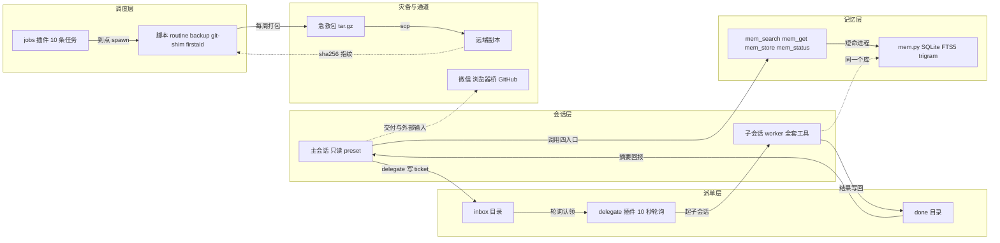
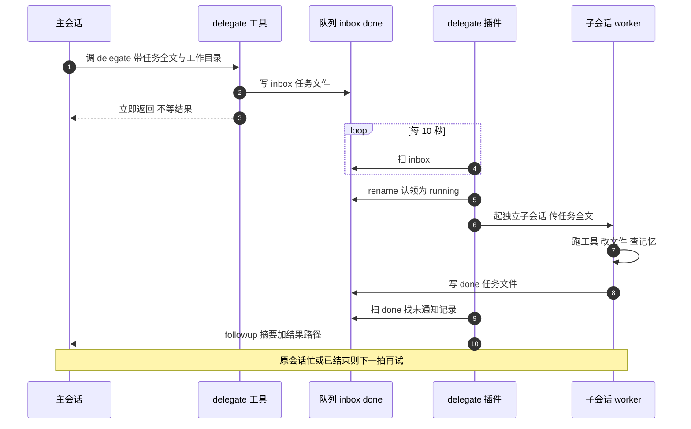

# 在鸿蒙平板上养一个本地超级智能体：派活、记忆、只读主会话、灾备

2026-11-05，这台机器是鸿蒙 PC，aarch64，Node v24.2.0 跑在 --jitless 下。没有 systemd，也不打算起常驻守护进程。下面这套东西就是在这个约束里长出来的：主会话派活，子会话干活，记忆落在本地 SQLite，定时任务挂在宿主进程里，急救包每周打一次包，再 scp 到远端。

## 一、为什么要在本地养一个

2026 年这波关停合并里，38 款 AI 产品下线或并进别的产品。昨天还能调的接口，今天 404；昨天还能导出的对话，今天只剩一个只读页面。把长期记忆和任务流水放在这种平台上，等于把账本寄存在别人的仓库里，仓库关门，账就没了。

数据出门是第二个理由。派活的任务原文、子会话的结果、记忆条目、调度流水，都是自己写的东西。里面会有路径、有项目名、有判断过程。云端的隐私条款写得再长，落到实现上就是数据在别人机器上。本地跑，拔了网线，这些东西还在磁盘上。

断网还想活是第三个理由。这套系统不依赖 GitHub、不依赖在线仓库、不依赖任何 API。队列是目录，状态是文件，记忆是 SQLite，调度器跟着宿主起停。断网的时候，派活、查记忆、跑备份照旧；网络恢复后再把急救包同步到远端。它的目标很窄：宿主还在，脑子就还在。

硬件限制反过来塑造了设计。aarch64 的鸿蒙 PC，Node 关掉 JIT，跑重运行时很吃力。所以这里没有消息中间件、没有向量库、没有常驻服务，只有几个插件、几个 python 脚本和一堆 JSON、markdown 文件。文件和标准库能解决的事，就不引入进程和依赖。

这套东西要解决的只有三件天天要做的事：派一个长任务、查一笔旧账、每周把状态打包带走。三件事都不需要模型在线，只需要会话里的模型能调工具。想清楚这一点，架构就简单了：模型在会话里，工具和数据都在本地，云只在我愿意的时候出现。

## 二、整体架构

三样东西各自独立：派活、记忆、调度。插件之间不互相调用，只共享一个数据根目录。

主会话是只读 preset，负责下指令、验收、记账。它调 delegate 时，任务被写成一个 JSON 文件丢进 inbox；插件每 10 秒轮一次，认领后起一个独立子会话当 worker。worker 干完把结果写进 done，插件再把一条摘要 followup 回原会话。队列就是目录，没有数据库，没有消息中间件；ls 能看，cp 能备份，手改也不会坏。

记忆有四个入口：mem_search 查、mem_get 取原文、mem_store 记一件、mem_status 体检。后端是 tools/mem.py，数据落在本地 SQLite 加 markdown 文件。worker 和主会话读同一个库，不经过网络。

调度器是 dshm-local-jobs，进程内定时器，任务表是 JSON。它只管一件事：到点 spawn 一个 argv 数组，超时杀整个进程组，把结果追加到 runs.jsonl。备份、体检、急救包、远端同步都挂在这上面。

灾备是单向的：本地打包成急救包，scp 到远端，两边各算一次 sha256，对上了才算完。它保的是本地没了还能拿回来；远端自己挂了，这套流程帮不上。

通道有三条。微信这一侧是收件口，成品用 dsh_im_return_file 递出去；浏览器桥给 browser_* 用，能开页、读元素树、点击、输入；GitHub 走 watch_* 盯 issue 和 PR，写操作改用 gh CLI。三条通道都不参与派活主链路，主链路断了它们也帮不上忙，但日常交付和外部输入靠它们。

## 三、只读主会话是怎么做到的

宿主给主会话挂的是只读 preset。它封的入口只有三个：write、edit、bash。python、move、publish、remove 这些还在工具面上；terminal 按设计也属于删不掉的那一类，但这套 profile 里根本没挂上（见坑四）。

这意味着只读是约定，不是墙。主会话想绕，用 python 写文件、用 move 挪目录、用 publish 把文件递出去，都能绕。真正让它守规矩的是 AGENTS.md 里那段提示词：主会话只做三件事，下指令、验收、记账；改文件、跑长命令、装东西、同步数据，一律先派出去。

为什么要把主会话按住？上下文。主会话的上下文要留着做判断、记结论、跟人对话。一次大文件读取、一次全量构建输出，能把它灌满；灌满之后要么压缩，要么开新会话，两种都丢信息。子会话是隔离的：它拿不到主会话的历史，任务必须写全；它跑完只回一段摘要和结果文件路径，脏活累活留在自己的上下文里。

派出去的子会话不受这条限制。实测它手里有全套工具，文件权限是 danger-full-access。所以主会话要改东西，派；派之前不用猜子会话能不能干，直接派，受限再回来报。这个不对称是有意的：主会话窄，worker 宽；窄的那一侧靠提示词自律，宽的那一侧靠任务边界约束。

一个边界要说清：主会话调不到 DSH 内置的终端工具。pty 探针能过，不代表工具挂上了；这套 profile 里 terminal_* 就是没有。要跑命令，派子会话，子会话的 bash 在。

## 四、派活链路

一次派活分五段：

1. 主会话调 delegate，任务全文、工作目录、回报会话一起写进 inbox 的任务 JSON。工具立即返回，不等结果。
2. 插件每 10 秒扫一次 inbox。扫到 JSON 先解析，坏的改名隔离，不阻塞后面的单。
3. 认领用 rename，把任务文件改成 running 后缀。同一文件系统内 rename 是原子的，两个轮询不可能拿到同一张单。
4. 插件起一个独立子会话，把任务全文传过去。worker 看不到主会话的上下文，所以任务必须自包含：要它查旧账，就在任务里写清楚查什么；要它改哪个文件，就写绝对路径。
5. worker 结束，结果写进 done 的任务 JSON。插件扫 done，找没通知过的记录，把摘要和结果路径 followup 回原会话。原会话忙或已经结束，这一拍不发，下一拍再试，记录一直留着。

结果全文留在 JSON 里，消息只带摘要。这样大结果不会灌回主会话，需要细节时按路径去读。

失败路径也留在文件里。JSON 解析失败的进 bad 后缀；宿主在 worker 跑一半时被杀，running 文件会留在 inbox，重启后不会自动重认领。这是有意的取舍：宁可不重复执行，也不猜任务有没有产生副作用。恢复方式是人工把文件改回任务 JSON。

## 五、记忆系统

记忆有四个入口，都是薄适配层，后端是 tools/mem.py：

- mem_search 按词检索，返回条目摘要；
- mem_get 取单件原文，超长截断；
- mem_store 追加一件，索引同事务更新；
- mem_status 报件数、漂移、最后写入。

存储是 SQLite + FTS5，分词器用 trigram。中文没有空格，按词切要先分词，按三字切不用：一条记录被切成三字片段，三字及以上的查询直接走索引，短查询退回 LIKE 兜底。这个选择不漂亮，但够用，而且不依赖任何模型或向量库。

现在库里 700 件。mem_status 会同时数索引和磁盘，missing 和 extra 各是多少；只有两边相等、missing 0、extra 0，才算对齐。手改过文件、批量导入过、换过机器，跑一次 reindex 重建索引；reindex 不删磁盘文件，只重建。

写入是原子的：先写临时文件，再 os.replace 成正式文件，索引在同一个 SQLite 事务里更新。写到一半失败会把临时文件删掉，不留磁盘有、索引没有的半件。并发靠 flock 串行化，单次动作有硬超时，插件那一层还有一层超时兜底。

检索的边界也清楚：三字以上走索引，短的词走 LIKE，标题和件名都参与。中文里两三个字的词很多，硬按词切会引入分词器，分词器又要词典、要更新、要处理新词；三字切片把这个问题绕开，代价是短查询会扫表。量级不大的时候，扫表的代价可以接受。

为什么不用向量库？单机、离线、量级不大，FTS5 的召回够用；向量库要模型、要常驻内存、要下载权重，这三样在这台机器上都是负担。记忆是账，检索够用就行。条目本身是 markdown，直接 grep、直接 cp、直接看，索引坏了还能从文件重建。

## 六、调度与灾备

dshm-local-jobs 是进程内调度器，任务表是纯 JSON，按 mtime 热重载。表里 10 条任务，常看的五条：

- routine：每小时跑一次日常步骤；
- backup：定点 03:10；
- git-shim：每半小时跑一次；
- 急救包：每周打包；
- 远端同步：每周一次。

调度语义按 systemd timer 的常用做法裁：错过一次补跑，错过太久只顺延，不补一串陈年任务；下次时间加抖动，避免整点一起醒；同一个 id 在跑就跳过这一拍；连续失败开始退避，成功一次清零；每次运行追加 runs.jsonl。任务用 argv 数组，不过 shell；超时对进程组发 SIGKILL，孙进程一起死。

急救包是本地状态的 tar.gz，现在 30.7MB。它和远端同步是两件事：急救包负责拿回来，远端同步负责多一份。同步前先把不该出门的东西剔掉：凭证、备份、文档大包、急救包 tar.gz 本身。剔完 2729 个文件，34.2 MiB，26 秒传完；远端从 685 个文件变成 2733 个。

传完两边各算一次 sha256，指纹比对通过才算同步成功，这次是通的；对不上就重传。这套流程没有增量协议、没有压缩协商，就是 scp 加校验；慢一点，但每一步都能看懂。

数字上有个小账要说明：本次同步的本地文件是 2729 个，远端同步后总数是 2733 个，差 4 个。这 4 个是远端根上早先留下的旧急救包 tar.gz，本地没有对应文件，同步时故意没删——灾备盘上多留几代包，比对齐数字重要。

## 七、踩过的五个坑

1. toybox tar 不认 `**`。打包脚本里写 `--exclude='x/**/__pycache__'` 不生效，照样把 pyc 打进包，实测多推了 38 个文件；改成 `--exclude='__pycache__'` 才排掉。GNU tar 的那套递归通配不能直接搬。
2. 宿主没有 workspace.list 这个名字。它被目录选择器的 list 占了，调就崩。绕法是不走这个名字：主会话用 python 列目录，或者派子会话去枚举。
3. profile 的 patch 文件每次启动被种子整份覆写。改完当时生效，下次启动打回原形。改它必须同步改种子，或者把改动放到不会被覆写的那一层。
4. DSH 内置终端工具在这个 profile 里根本没挂。pty 探针 ok，只说明伪终端能开，不代表 terminal_* 注册了。要跑命令就派子会话，子会话的 bash 在。
5. github API 的 PUT 走 SDK 封装会报 400，返回 Body should be a JSON object。同一个请求改用 gh CLI 就过了，认证走本机已有的 token。

五个坑里有四个是名字或路径看起来对、实际不是那个东西：tar 的 `**`、workspace.list、patch 的种子、pty 探针。剩下一个是 SDK 封装的请求体。共同点是错误信息都不指向根因，得顺着实际执行的命令一层层看。

这五个坑也都不在业务代码里，而在宿主、工具链和名字空间。写代码之前先确认工具真的存在、名字真的没被占、配置文件真的不会被覆写，比事后 debug 省时间。尤其是 HarmonyOS 这套 toybox 工具链，GNU 世界的习惯不能直接搬。

## 八、复现清单

按这个顺序来，少一步都会在某个地方卡住：

1. 装三个插件：dshm-local-delegate、dshm-local-memory、dshm-local-jobs。放进 profiles/ondevice/node_modules，把 @deepseek-ai/dsh-tools 软链进去，在 cordis.patch.yml 里登记，重启宿主。工具面出现 delegate、mem_*、jobs_* 才算装好。
2. 把记忆后端 tools/mem.py 放到插件默认位置，跑一次 reindex，再用 mem_status 确认 missing 0、extra 0。
3. 在 AGENTS.md 里写派活规矩：主会话只查、判、派；改文件、跑长命令、装东西、同步数据一律派子会话；只读 preset 只封三个入口，别拿 python 绕。
4. 跑一次 firstaid 打包，确认 tar.gz 生成、大小合理、能解开。打包命令别用 `**`，用 find 清单。
5. 配远端灾备：scp 目标、ssh 凭据、排除清单、sha256 校验。先手动跑一次完整同步，核对文件数和指纹，再挂到调度器的每周任务上。
6. 最后把 routine、backup、git-shim 这些任务按自己的节奏填进任务表，先留一条 disabled 的样例，确认热重载生效再开。

这份清单里最容易漏的是第 3 步。插件装好、工具面出现，只说明适配层在；主会话会不会照着规矩派活，取决于 AGENTS.md 有没有写、写得多具体。提示词里只写尽量派活，主会话还是会自己动手；写成改文件、跑长命令一律派，它才停。

## 九、数字与日期

全部来自 2026-11-05 这次实测：

- 日期：2026-11-05
- 设备：鸿蒙 PC，aarch64，Node v24.2.0 --jitless
- 插件：3 个
- 调度任务：10 条
- 记忆：700 件，索引与磁盘 missing 0、extra 0
- 急救包：30.7MB
- 同步：2729 个文件，34.2 MiB，26 秒
- 远端：685 个文件变 2733 个
- 关停合并：2026 年这波 38 款 AI 产品

这套东西不轻，也不适合所有人。它适合的场景很具体：一台自己的机器、一个长期用的助手、一批不想出门的数据、一个能接受宿主停就停的预期。云平台省心，本地可审计。选哪个，看你能接受哪种代价。
